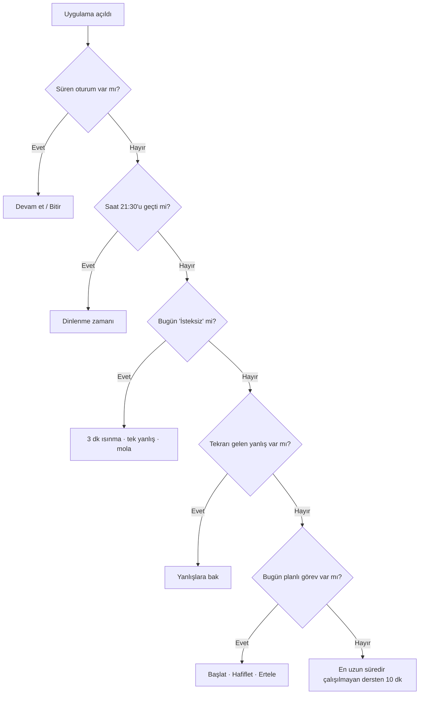
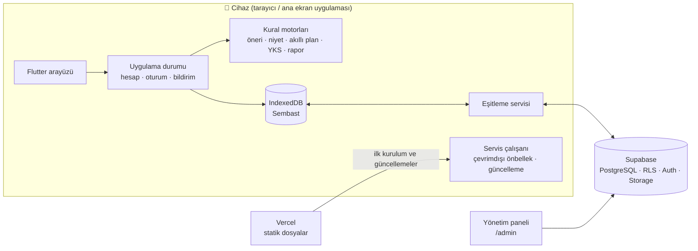

<h1 align="center">📚 DersAsistanım</h1>

<p align="center">
  <b>Ders çalışmayı planlayan, takip eden ve eğlenceli hale getiren maskotlu çalışma asistanı.</b><br>
  İlkokul, ortaokul (LGS) ve lise (YKS) öğrencileri için · Öğretmen ve veli hesaplarıyla · İnternetsiz çalışır
</p>

<p align="center">
  <a href="https://dersasistanim.vercel.app"></a>
  
  
  
  
  
  
</p>

<p align="center">
  <a href="https://dersasistanim.vercel.app"><b>▶ Uygulamayı aç</b></a>
  &nbsp;·&nbsp;
  <a href="https://osmnnuri.github.io"><b>Güncel görseller için siteme göz at</b></a>
</p>


---

## İçindekiler

- [Neden?](#neden)
- [Hesap türleri](#hesap-türleri)
- [Özellikler](#özellikler)
- [Lise ve YKS](#lise-ve-yks)
- [Maskot asistan nasıl düşünür?](#maskot-asistan-nasıl-düşünür)
- [Akıllı program](#akıllı-program)
- [Bildirimler](#bildirimler)
- [Mimari](#mimari)
- [Gizlilik ve KVKK](#gizlilik-ve-kvkk)
- [Kullanılan teknolojiler](#kullanılan-teknolojiler)
- [Kalite](#kalite)
- [Yol haritası](#yol-haritası)
- [İletişim](#i̇letişim)

---

## Neden?

Öğrenciler için ders çalışmanın en zor kısmı çoğu zaman **başlamak** ve **devam ettirmektir**. Öğretmen ve veli ise öğrencinin evde ne kadar çalıştığını göremez. DersAsistanım baskı kurmadan, küçük adımlarla çalışmaya yönlendirir ve öğretmenle veliyi aynı tabloya baktırır:

- 🐱 Öğrenciyle konuşan, ruh haline göre değişen bir **maskot arkadaş** (8 maskot)
- 🗓️ Okul ve koçluk ders programına göre kendiliğinden hazırlanan **haftalık plan**
- ⏱️ Tek dokunuşla başlayan **çalışma kronometresi**
- 📕 Unutulmasın diye aralıklarla hatırlatan, fotoğraflı **yanlış defteri**
- 🎯 Lisede **YKS sayacı, puan hesaplayıcı, deneme ve konu takibi**
- 👩‍🏫 **Öğretmen** ödev ve duyuru verir, 👪 **veli** çocuğunun raporunu görür

## Hesap türleri

| Rol | Nasıl açılır | Ne yapar |
|---|---|---|
| 🎒 **Öğrenci** | Kendisi kaydolur (ilkokul / ortaokul / lise) | Plan, kronometre, soru kaydı, yanlış defteri, gelişim; lisede YKS bölümü |
| 👩‍🏫 **Öğretmen** | Okul yöneticisi yönetim panelinden açar | 6 haneli öğretmen koduyla bağlanan öğrencilerin raporu, ödev ve duyuru |
| 👪 **Veli** | Kendisi kaydolur | Öğrencinin verdiği 6 haneli veli koduyla bağlanır; çocuğun raporunu salt okunur görür |

Bir öğrencinin aynı anda bir öğretmeni ve birden çok velisi olabilir. Öğretmen ve veli raporunda çalışmalar, plan, yanlış defteri, okul ve koçluk ders programları, ödevler ve (lisede) YKS bölümü yer alır.

## Özellikler

| | Özellik | Açıklama |
|---|---|---|
| 🏠 | **Ana sayfa asistanı** | Günün önerisi, hızlı mesajlar ("10 dk çalış", "Gelişiyor muyum?", "Zorlanıyorum"…) ve serbest yazı kutusu. Bugünkü süre, görev ve seri kutucukları. |
| 😊 | **Ruh hali** | "İyi / İdare eder / Yorgun / İsteksiz". İsteksiz günlerde asistan büyük hedefler yerine 3 dakikalık ısınma önerir. |
| 🗓️ | **Haftalık plan** | Görev ekleme, tek dokunuşla tamamlama, erteleme, hafifletme, gün seçme. |
| 📋 | **12 hazır program** | Hafif, Dengeli, LGS hazırlık, Sayısal/Sözel ağırlıklı, Tekrar haftası, Yazılı haftası… lisede YKS dengeli, TYT odaklı, AYT sayısal. Haftalık önizlemeli. |
| 📚 | **Derslerim ve programlar** | Seçmeliler dahil kendi derslerini ekleme; **okul** ve **koçluk** ders programını tablo olarak düzenleme. |
| ✨ | **Akıllı program** | Ders programına bakıp tekrar, hazırlık ve soru çözümü görevlerini yerleştirir. |
| ⏱️ | **Kronometre** | Ders seç ve başla. Hedef süreler, ilerleme halkası, duraklat, ders değiştir. Ekran açık kalır. |
| ✏️ | **Soru kaydı** | Doğru/yanlış/boş kaydı; LGS ve YKS net kuralı. |
| 📕 | **Yanlış defteri** | Fotoğraflı soru kaydı (buluta eşitlenir) ve **aralıklı tekrar**: 2 gün → 3 → 7 → 14 gün. |
| 📈 | **Gelişim** | Haftalık süre, oturum, soru ve doğruluk özeti; ders bazında süre ve 6 haftalık doğruluk grafikleri. |
| 📨 | **Öğretmenden** | Öğretmenin duyuruları ve ödevleri ana sayfada; ödev tamamlandı olarak işaretlenir. |
| 🎨 | **Kişiselleştirme** | 8 maskot (Pamuk, Fındık, Bilge, Robo, Rex, Kral, Zeynep, Emir) ve ikisi koyu 10 renk teması. |
| 🔔 | **Maskot bildirimleri** | Çalışmaya çağıran ve uzun süre girilmeyince "Neredesin?" diye soran nazik hatırlatmalar. |
| 🎓 | **Uygulama turu** | İlk açılışta gerçek ekran öğelerini vurgulayan tanıtım. |
| 🤍 | **Baskı yapma modu** | Doğruluk grafiklerini varsayılan olarak gizler. |

## Lise ve YKS

Öğrenci lise düzeyini seçince dersler ve arayüz değişir:

- ⏳ **YKS geri sayımı**: sınava kalan gün ve hafta ana sayfada.
- 🧮 **Puan hesaplayıcı**: TYT ve AYT netlerinden ham puan; SAY / EA / SÖZ / DİL alanı ve diploma notundan OBP katkısı.
- 📝 **Denemelerim**: TYT/AYT deneme kaydı, son net, değişim, en iyi ve son 5 ortalaması; net gelişimi grafiği.
- ✅ **Konu takibi**: ders ders TYT/AYT konuları; "Başlamadım / Tekrar lazım / Bitti" durumu ve genel yüzde.

## Maskot asistan nasıl düşünür?

Asistan bir dil modeli **değildir**. Cihazda çalışan, açıklanabilir **kurallar** kullanır. Bu bilinçli bir tercih: ücretsiz, çevrimdışı ve gizlilik dostu.



- **Türkçe yazı anlama:** Metin sadeleştirilir (ş→s, ı→i) ve anahtar kelimelerle eşleştirilir. *"20 doğru 5 yanlış matematik"* yazılırsa sayılar ve ders çıkarılıp kayıt formu doldurulur.
- **Güvenlik:** Kendine zarar verme ifadeleri algılanırsa ders önerileri tamamen durur. Yerine "güvendiğin bir büyüğüne anlat, acil durumda 112" mesajı yumuşak bir kartta gösterilir.
- **Gelişim yorumu:** Son 28 günün doğruluğu önceki 28 günle karşılaştırılır. Fark %5'ten büyükse yükseliş ya da düşüş olarak yorumlanır.

## Akıllı program

Öğrenci **okul ders programını** gün gün girer. Planlayıcı haftayı şöyle kurar:

| Gün | Ne planlanır? |
|---|---|
| Okul günleri | O gün okulda işlenen derslerin **tekrarı** + ertesi günün derslerine **hazırlık** |
| Cuma | Yalnızca tekrar (ertesi gün okul yok) |
| Cumartesi | Haftada en çok saati olan derslerden **soru çözümü** |
| Pazar | **Haftalık tekrar** + **pazartesiye hazırlık** |

Süreler derslerin haftalık saatiyle orantılı dağıtılır (10–45 dk). Yoğunluk seçilebilir: **Hafif**, **Dengeli**, **Yoğun**. Uygulamadan önce gün gün önizleme gösterilir. Dershane ya da özel ders için ayrı bir **koçluk ders programı** da tutulur ve raporlarda görünür.

## Bildirimler

Duolingo tarzı ama nazik. Maskot kendi sesiyle yazar:

> **Pamuk** · Miyav... Neredesin Ela? Dün kucağına kıvrılıp seni bekledim.
>
> **Fındık** · Hav hav! Neredesin Ela? Kapının önünde seni bekledim!
>
> **Bilge** · Huu huu! 4 günlük serin tehlikede Ela, gel koruyalım.

**Kurallar** (öncelik sırasıyla): 1, 3 ya da 7 gündür girilmediyse *"Neredesin?"* → seri varsa ve akşam olduysa *"Serin tehlikede"* → tekrarı gelen yanlışlar → plandaki görevler → genel çalışma çağrısı.

**Sınırlar:** 21:30–08:00 arası sessiz. Günde en fazla bir hatırlatma gider. O gün çalışıldıysa hiç gönderilmez.

## Mimari



Kod katmanları:

```
core/      gün hesapları, kimlik üretimi, saat
data/      veri modelleri, depolar, hesap ve sınıf arka uçları
engine/    saf kural motorları: öneri, akıllı plan, YKS puanı, rapor (birim testli)
sync/      cihaz ↔ Supabase eşitlemesi
app/       uygulama durumu, hesap, oturum, bildirimler
platform/  tarayıcıya özel işler (dosya, ekran kilidi, bildirim, fotoğraf)
mascot/    maskot paketleri (SVG + cümleler)
admin/     okul yöneticisinin öğretmen açtığı yönetim paneli
ui/        öğrenci, öğretmen ve veli ekranları
```

### Önce çevrimdışı

- Veri önce cihazdaki IndexedDB'ye yazılır; uygulama internet olmadan tam çalışır. Bağlantı gelince değişiklikler Supabase'e eşitlenir.
- İlk açılışta uygulamanın tüm dosyaları (emoji fontu dahil) cihaza alınır.
- Yeni sürüm arka planda iner, üstte **"Yeni sürüm hazır → Güncelle"** uyarısı çıkar; dokununca sayfa bir kez yenilenir.
- Emojiler çevrimdışıyken de görünsün diye uygulamayla gelen **Noto Color Emoji alt kümesinden** çizilir.

## Gizlilik ve KVKK

Uygulama çocuk verisi işlediği için gizlilik baştan tasarlandı:

- 📄 **Aydınlatma metni** giriş ekranından, kayıttan ve Ayarlar'dan açılır; kayıtta **zorunlu onay** alınır ve onaylanan metin sürümü saklanır.
- 🗑️ **"Hesabımı ve verilerimi sil"**: fotoğraflar depodan, hesap ve tüm bulut verisi veritabanından, cihazdaki veri de tarayıcıdan silinir.
- 🔐 Veritabanında **satır düzeyi güvenlik (RLS)**: öğrenci yalnızca kendi verisini; öğretmen ve veli yalnızca bağlı oldukları öğrencinin verisini okuyabilir. Veli erişimi salt okunurdur.
- 🚫 Analitik veya reklam yoktur; veri üçüncü taraflarla paylaşılmaz.

## Kullanılan teknolojiler

| Alan | Teknoloji |
|---|---|
| Arayüz | [Flutter](https://flutter.dev) (Dart 3, Material 3) — web için derlenir |
| Uygulama türü | Progressive Web App (PWA), özel servis çalışanı |
| Yerel veri | [Sembast](https://pub.dev/packages/sembast) + IndexedDB |
| Bulut | [Supabase](https://supabase.com): PostgreSQL, Auth, Storage, satır düzeyi güvenlik, SQL migration'ları |
| Grafikler | [fl_chart](https://pub.dev/packages/fl_chart) |
| Maskot çizimleri | SVG + [flutter_svg](https://pub.dev/packages/flutter_svg) |
| Fotoğraf | [image_picker](https://pub.dev/packages/image_picker) (1280 px'e küçültme) |
| Emoji | Noto Color Emoji alt kümesi (OFL) |
| Barındırma | [Vercel](https://vercel.com) (statik dosya) |

## Kalite

- ✅ **454 otomatik test**: kural motorları, veri modelleri, eşitleme, hesap ve rol akışları, öğretmen/veli ekranları, KVKK ve servis çalışanı.
- ✅ `flutter analyze` temiz.
- ✅ Her özellik ayrı dalda geliştirilir, PR ile birleştirilir ve yayından önce canlı ortamda doğrulanır.
- ✅ Küçük ekran testleri: 375×667 (iPhone SE) ekranda da sorunsuz.

## Yol haritası

- [x] Maskotlu asistan, plan, kronometre, yanlış defteri, gelişim
- [x] Hazır programlar ve ders programına göre akıllı program
- [x] Çevrimdışı çalışma ve güvenli güncelleme
- [x] Maskot bildirimleri (cihazda)
- [x] Hesap ve cihazlar arası eşitleme (Supabase)
- [x] Öğretmen hesabı: rapor, ödev, duyuru; yönetim paneli
- [x] Veli hesabı: çocuğun raporunu salt okunur görme
- [x] Lise ve YKS: sayaç, puan hesaplayıcı, deneme ve konu takibi
- [x] Koçluk ders programı
- [x] KVKK: aydınlatma metni, onay, hesap ve veri silme
- [ ] Uygulama kapalıyken bildirim (Web Push + zamanlanmış sunucu işi)
- [ ] Android / iOS mağaza uygulaması

## Kaynak kod

Kaynak kod özel bir depoda tutuluyor; inceleme için talep üzerine paylaşılabilir.

## İletişim

**osmnnuri** · [Web sitesi](https://osmnnuri.github.io) · [GitHub](https://github.com/osmnnuri) · osmannuriyasar57@gmail.com
