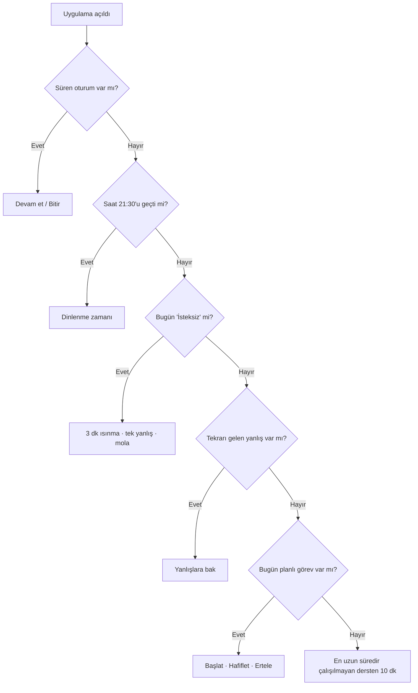
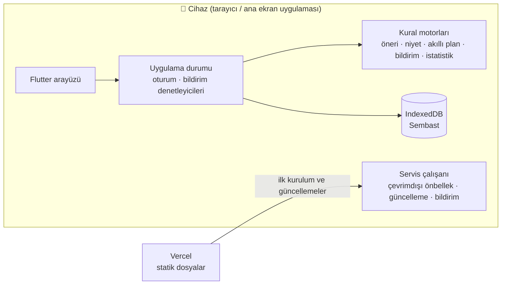

<h1 align="center">📚 DersAsistanım</h1>

<p align="center">
  <b>Ders çalışmayı planlayan, takip eden ve eğlenceli hale getiren maskotlu çalışma asistanı.</b><br>
  Ortaokul ve LGS öğrencileri için · İnternetsiz çalışır · Tüm veri cihazda kalır
</p>

<p align="center">
  <a href="https://dersasistanim.vercel.app"></a>
  
  
  
  
  
</p>

<p align="center">
  <a href="https://dersasistanim.vercel.app"><b>Uygulamayı dene →</b></a>
</p>

> Bu depo bir **vitrindir**: projenin bugünkü halini anlatır. Kaynak kod ayrı ve gizli bir depoda geliştirilmektedir.

---

## İçindekiler

- [Neden?](#neden)
- [Özellikler](#özellikler)
- [Maskot asistan nasıl düşünür?](#maskot-asistan-nasıl-düşünür)
- [Akıllı program](#akıllı-program)
- [Bildirimler](#bildirimler)
- [Mimari](#mimari)
- [Gizlilik ve veri](#gizlilik-ve-veri)
- [Kullanılan teknolojiler](#kullanılan-teknolojiler)
- [Kalite](#kalite)
- [Yol haritası](#yol-haritası)

---

## Neden?

Ortaöğretim öğrencileri için ders çalışmanın en zor kısmı çoğu zaman **başlamak** ve **devam ettirmektir**. DersAsistanım baskı kurmadan, küçük adımlarla çalışmaya yönlendirir:

- 🐱 Öğrenciyle konuşan, ruh haline göre değişen bir **maskot arkadaş**
- 🗓️ Okul ders programına göre kendiliğinden hazırlanan **haftalık plan**
- ⏱️ Tek dokunuşla başlayan **çalışma kronometresi**
- 📕 Unutulmasın diye aralıklarla hatırlatan **yanlış defteri**
- 📈 Gelişimi gösteren sade **grafikler**

Hesap açmak, internet ya da ücret gerekmez.

## Özellikler

| | Özellik | Açıklama |
|---|---|---|
| 🏠 | **Ana sayfa asistanı** | Günün önerisi, hızlı mesajlar ("10 dk çalış", "Gelişiyor muyum?", "Zorlanıyorum"…) ve serbest yazı kutusu. Bugünkü süre, görev ve seri kutucukları. |
| 😊 | **Ruh hali** | "İyi / İdare eder / Yorgun / İsteksiz". İsteksiz günlerde asistan büyük hedefler yerine 3 dakikalık ısınma önerir. |
| 🗓️ | **Haftalık plan** | Görev ekleme, tek dokunuşla tamamlama, erteleme, hafifletme, gün seçme. |
| 📋 | **9 hazır program** | Hafif, Dengeli, Okul sonrası rutini, LGS hazırlık, Sayısal, Sözel, Hafta sonu yoğun, Tekrar haftası, Yazılı haftası. Haftalık önizlemeli. |
| 📚 | **Derslerim** | Seçmeli dahil kendi derslerini ekleme ve gün gün okul ders programı. |
| ✨ | **Akıllı program** | Ders programına bakıp tekrar, hazırlık ve soru çözümü görevlerini yerleştirir. |
| ⏱️ | **Kronometre** | Ders seç ve başla. 5/10/15/25 dk hedefler, ilerleme halkası, duraklat, ders değiştir. Ekran açık kalır. |
| ✏️ | **Soru kaydı** | Doğru/yanlış/boş kaydı. İsteğe bağlı **LGS neti** (doğru − yanlış ÷ 3). |
| 📕 | **Yanlış defteri** | Fotoğraflı soru kaydı ve **aralıklı tekrar**: 2 gün → 3 → 7 → 14 gün. |
| 📈 | **Gelişim** | Haftalık süre, oturum, soru ve doğruluk özeti. Ders bazında süre ve 6 haftalık doğruluk grafikleri. |
| 🔔 | **Maskot bildirimleri** | Çalışmaya çağıran ve uzun süre girilmeyince "Neredesin?" diye soran nazik hatırlatmalar. |
| 🎓 | **Uygulama turu** | İlk açılışta gerçek ekran öğelerini vurgulayan 8 adımlık tanıtım. |
| 💾 | **Yedekleme** | Tek dosyaya yedek alma ve doğrulamalı geri yükleme. |
| 🤍 | **Baskı yapma modu** | Doğruluk grafiklerini varsayılan olarak gizler. |

### Maskotlar

| Pamuk 🐱 | Fındık 🐶 | Bilge 🦉 |
|---|---|---|
| *"Miyav! Patilerim hazır, 10 dakika çalışalım mı?"* | *"Hav! Kuyruğumu sallıyorum, hadi biraz ders çalışalım!"* | *"Huu! Bilgelik küçük adımlarla gelir. 10 dakika?"* |

Her maskotun 5 ruh hali (boşta, mutlu, düşünceli, cesaretlendiren, uykulu) ve kendine özgü cümleleri vardır.

## Maskot asistan nasıl düşünür?

Asistan bir dil modeli **değildir**. Cihazda çalışan, açıklanabilir **kurallar** kullanır. Bu bilinçli bir tercih: ücretsiz, çevrimdışı ve gizlilik dostu.



- **Türkçe yazı anlama:** Metin sadeleştirilir (ş→s, ı→i) ve anahtar kelimelerle eşleştirilir. *"20 doğru 5 yanlış matematik"* yazılırsa sayılar ve ders çıkarılıp kayıt formu doldurulur.
- **Güvenlik:** Kendine zarar verme ifadeleri algılanırsa ders önerileri tamamen durur. Yerine "güvendiğin bir büyüğüne anlat, acil durumda 112" mesajı yumuşak bir kartta gösterilir.
- **Gelişim yorumu:** Son 28 günün doğruluğu önceki 28 günle karşılaştırılır. Fark %5'ten büyükse yükseliş ya da düşüş olarak yorumlanır.

## Akıllı program

Öğrenci **okul ders programını** gün gün girer. Planlayıcı haftayı şöyle kurar:

| Gün | Ne planlanır? |
|---|---|
| Okul günleri | O gün okulda işlenen derslerin **tekrarı** + ertesi günün derslerine **hazırlık** |
| Cuma | Yalnızca tekrar (ertesi gün okul yok) |
| Cumartesi | Haftada en çok saati olan derslerden **soru çözümü** |
| Pazar | **Haftalık tekrar** + **pazartesiye hazırlık** |

Süreler derslerin haftalık saatiyle orantılı dağıtılır (10–45 dk). Yoğunluk seçilebilir: **Hafif** (okul günü ~30 dk), **Dengeli** (~50 dk), **Yoğun** (~75 dk). Uygulamadan önce gün gün önizleme gösterilir.

## Bildirimler

Duolingo tarzı ama nazik. Maskot kendi sesiyle yazar:

> **Pamuk** · Miyav... Neredesin Ela? Dün kucağına kıvrılıp seni bekledim.
>
> **Fındık** · Hav hav! Neredesin Ela? Kapının önünde seni bekledim!
>
> **Bilge** · Huu huu! 4 günlük serin tehlikede Ela, gel koruyalım.

**Kurallar** (öncelik sırasıyla):

1. 1, 3 ya da 7 gündür girilmediyse → *"Neredesin?"*
2. Seri varsa ve akşam olduysa → *"Serin tehlikede"*
3. Tekrarı gelen yanlış sorular varsa → hatırlatma
4. Plandaki görevler varsa → hatırlatma
5. Hiçbiri yoksa → genel çalışma çağrısı

**Sınırlar:** 21:30–08:00 arası sessiz. Günde en fazla bir hatırlatma gider. O gün çalışıldıysa hiç gönderilmez.

## Mimari



Kod katmanları:

```
core/      gün hesapları, kimlik üretimi, saat
data/      veri modelleri ve depolar (9 depo)
engine/    saf kural motorları: arayüzden bağımsız, birim testli
app/       uygulama durumu, oturum, asistan eylemleri, bildirimler
platform/  tarayıcıya özel işler (dosya, ekran kilidi, bildirim, fotoğraf)
mascot/    maskot paketleri (SVG + cümleler)
ui/        ekranlar
```

### Çevrimdışı çalışma ve güncelleme

- İlk açılışta uygulamanın tüm dosyaları (emoji fontu dahil) cihaza alınır. Sonraki açılışlar internetsiz çalışır.
- Yeni sürüm arka planda iner ve kullanıcıyı rahatsız etmeden bekler. Üstte **"Yeni sürüm hazır → Güncelle"** uyarısı çıkar. Dokununca sayfa bir kez yenilenir ve eski dosyalar temizlenir.
- Emojiler, çevrimdışıyken de görünsün diye uygulamayla birlikte gelen **244 KB'lık bir Noto Color Emoji alt kümesinden** çizilir.

## Gizlilik ve veri

- 🔒 **Sunucu yok, hesap yok.** Tüm veri öğrencinin cihazında, tarayıcının içinde (IndexedDB) tutulur.
- 🚫 Hiçbir veri üçüncü taraflara ya da geliştiriciye gönderilmez. Analitik veya reklam yoktur.
- 💾 Cihaz değiştirmek için yedek dosyası alınıp yeni cihazda geri yüklenir.
- 🧭 İleride hesap ve senkronizasyon eklenirse kullanılacak bulut şeması (Postgres/Supabase, satır düzeyi güvenlik) **tasarlandı ama uygulanmadı**. Çocuk verisi olduğu için KVKK, veli onayı ve "verilerimi sil" akışı şart olarak planlandı.

## Kullanılan teknolojiler

| Alan | Teknoloji |
|---|---|
| Arayüz | [Flutter](https://flutter.dev) (Dart 3, Material 3) — web için derlenir |
| Uygulama türü | Progressive Web App (PWA), özel servis çalışanı |
| Veritabanı | [Sembast](https://pub.dev/packages/sembast) + IndexedDB |
| Grafikler | [fl_chart](https://pub.dev/packages/fl_chart) |
| Maskot çizimleri | SVG + [flutter_svg](https://pub.dev/packages/flutter_svg) |
| Fotoğraf | [image_picker](https://pub.dev/packages/image_picker) (1280 px'e küçültme) |
| Emoji | Noto Color Emoji alt kümesi (OFL) |
| Barındırma | [Vercel](https://vercel.com) (statik dosya) |

## Kalite

- ✅ **315 otomatik test**: kural motorları, veri modelleri, yedekleme, ekran akışları ve servis çalışanı.
- ✅ `flutter analyze` temiz.
- ✅ Her özellik ayrı dalda geliştirilir, PR ile birleştirilir ve yayından önce canlı ortamda doğrulanır.
- ✅ Küçük ekran testleri: tanıtım turu 375×667 (iPhone SE) ekranda da sorunsuz.

## Yol haritası

- [x] Maskotlu asistan, plan, kronometre, yanlış defteri, gelişim
- [x] Hazır programlar ve ders programına göre akıllı program
- [x] Çevrimdışı çalışma ve güvenli güncelleme
- [x] İlk açılış turu
- [x] Maskot bildirimleri (cihazda)
- [x] Bulut veri şeması tasarımı
- [ ] Uygulama kapalıyken bildirim (Web Push + zamanlanmış sunucu işi)
- [ ] Hesap ve cihazlar arası senkronizasyon
- [ ] Veli görünümü (haftalık özet)
- [ ] Android / iOS mağaza uygulaması

---

<p align="center">
  Türkiye'deki öğrenciler için 🇹🇷 sevgiyle geliştirildi.
</p>
